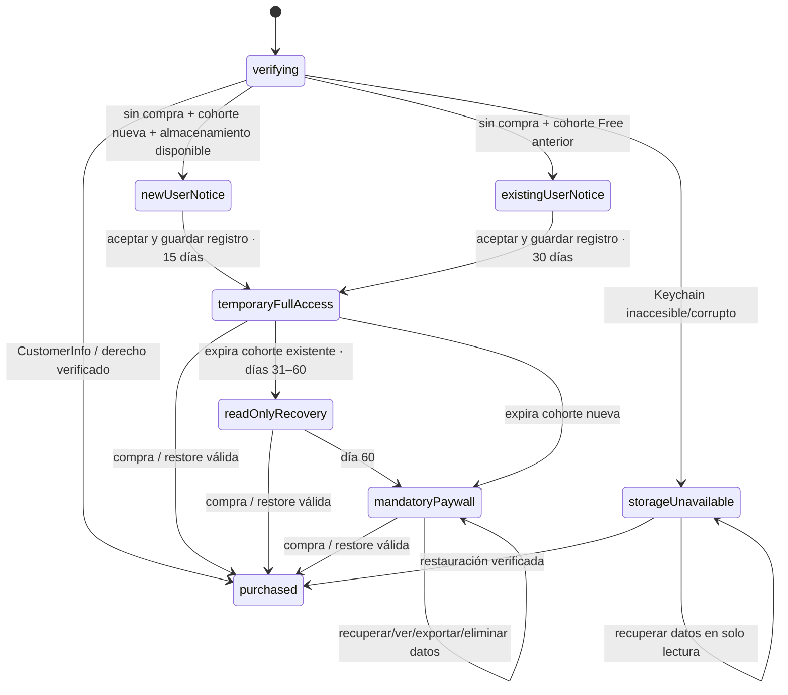

# Máquina de estados de acceso

## Precedencia

1. Entitlement de pago activo verificado por RevenueCat, o derecho vitalicio CloudKit validado en producción → `purchased` / FULL.
2. RevenueCat mantiene activo el entitlement durante cualquier gracia real confirmada → FULL. Un billing retry sin entitlement activo no lo crea.
3. Acceso temporal FULL aún vigente.
4. Recuperación legacy en solo lectura y dentro de fecha.
5. Paywall obligatorio. Problemas de persistencia/verificación usan estados seguros que nunca crean otro periodo.

## Flujo

## Capacidades

| Estado | FULL de producto | Ver/exportar/eliminar datos propios | Compra/restore/gestión | Legal/soporte/apariencia | Escrituras del producto y sync |
|---|---:|---:|---:|---:|---:|
| `purchased` | Sí | Sí | Sí | Sí | Sí, según capacidades contratadas |
| `temporaryFullAccess` | Sí | Sí | Sí | Sí | Sí, igual que Premium pagado |
| `readOnlyRecovery` | No | Sí | Sí | Sí | No: create/modify/import/cloud writes bloqueados |
| `mandatoryPaywall` | No | Sí, con herramientas mínimas | Sí | Sí | No |
| `verifying` | No hasta confirmar | Sí por ruta de recuperación | Sí | Sí | No |
| `storageUnavailable` | No se inicia acceso nuevo | Sí cuando haya datos legibles | Sí | Sí | No |
| Aviso nuevo/legacy | Aún no | Sí, con ruta propia | Sí | Sí | No hasta que se guarde la aceptación |

`AccessPolicy` resuelve autorización; `AccessCapability` es la matriz común. `PremiumManager.isPro` es una proyección del acceso FULL y solo se usa para mostrar/coordinar funciones, no como autorización persistida. Las operaciones de `AppState` y `CloudSyncManager` también guardan capacidades.

## Tiempo y persistencia

- Defaults configurables en `AccessConfiguration`: 15 días nuevos, 30 días full existentes, 30 días recovery.
- `Date` almacena un instante absoluto (UTC internamente); el vencimiento suma días calendario usando el calendario/zona local al activar para respetar días naturales/DST. Se guarda una sola vez en Keychain.
- `lastTrustedAt` solo avanza (`max(candidate, lastTrustedAt)`) y se persiste como máximo una vez por hora para reducir escrituras. El adelanto del reloj puede caducar antes el periodo; el retroceso no lo reinicia.
- `noticeVersion` y `noticeAcceptedAt` versionan el aviso aceptado. El inicio se guarda en Keychain antes de conceder acceso. No se emite un evento de analítica al pulsar activar.
- El estado de compra es distinto al estado temporal. El botón de acceso temporal no llama a StoreKit ni a RevenueCat para comprar.
