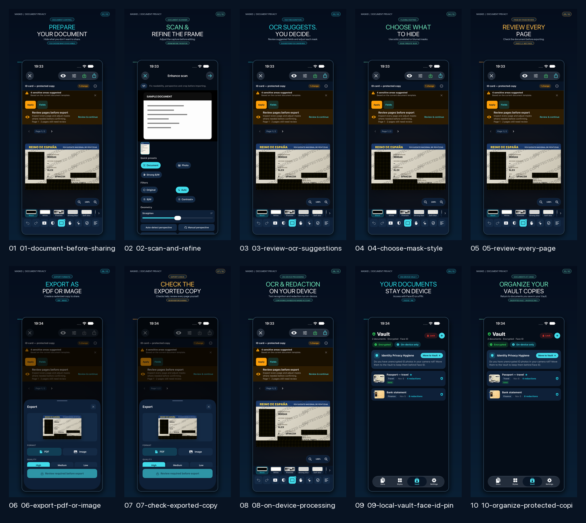
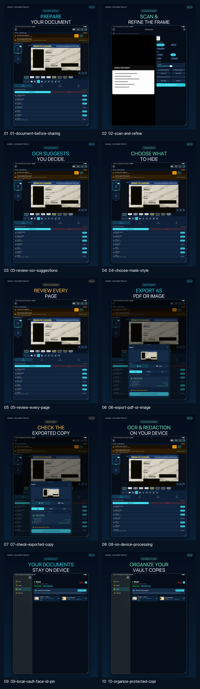

# ASO creatividades y capturas — MaskID 1.1.7

## Entrega creativa

La ficha de 1.1.7 usa **10 creatividades por dispositivo y locale**: es-ES y en-US, en iPhone de 6,9″ e iPad de 13″ (40 PNG en total). Cada pieza combina UI auténtica del build `1172026110801` con titular, explicación corta y llamada visual sobre una fortaleza concreta. No son diez capturas planas ni se ha redibujado la interfaz.

| Dispositivo | Resolución | Directorios por locale |
| --- | --- | --- |
| iPhone 6,9″ (`IPHONE_DYNAMIC_ISLAND_LARGE_PROFILE`) | 1320 × 2868 | [`iphone-6.9/es-ES`](creatives/1.1.7/iphone-6.9/es-ES) · [`iphone-6.9/en-US`](creatives/1.1.7/iphone-6.9/en-US) |
| iPad Pro 13″ (`IPAD_13_PROFILE`) | 2064 × 2752 | [`ipad-13/es-ES`](creatives/1.1.7/ipad-13/es-ES) · [`ipad-13/en-US`](creatives/1.1.7/ipad-13/en-US) |

Fortalezas presentadas en secuencia: preparar una copia antes de compartir; escanear y corregir el encuadre; revisar sugerencias OCR; elegir zonas y estilos de máscara; revisar cada página; exportar PDF o imagen rasterizada; comprobar la copia exportada; procesamiento de OCR/redacción en el dispositivo y flujo principal sin cuenta MaskID; Bóveda local con Face ID o PIN; organización de documentos guardados en la Bóveda. Los mensajes no atribuyen detección perfecta ni garantizan que el usuario haya seleccionado todos los datos sensibles.

## Evidencia visual y manifiesto

- Manifiesto con orden, copy localizado, hashes de source/output y dimensiones: [`CREATIVE_SET_MANIFEST.json`](creatives/1.1.7/CREATIVE_SET_MANIFEST.json).
- Generador reproducible de layouts editoriales sobre capturas reales: [`compose_aso_creatives_1_1_7.py`](../../../../scripts/compose_aso_creatives_1_1_7.py).
- Hoja iPhone es-ES: 
- Hoja iPhone en-US: 
- Hoja iPad es-ES: 
- Hoja iPad en-US: 

Cada directorio pasó `asc screenshots validate`: 10 archivos listos, 0 errores, 0 advertencias. El manifiesto registra resolución exacta y SHA-256. Las imágenes son PNG RGB sin canal alfa.

## Capturas de origen y tema

Las pantallas fuente permanecen intactas bajo [`final/1.1.7`](final/1.1.7) y las capturas originales de XCTest bajo [`raw`](raw). `testASOCaptureScreensUseBaseThemeInBothStoreLocales` pasó en iPhone 18 Pro Max e iPad Pro 13″. Antes de capturar es-ES y en-US, verificó **MaskID Original** activo y temas estacionales desactivados. Los documentos mostrados son fixtures sintéticos.

La secuencia no incluye la pantalla de Inicio: el encabezado de la biblioteca queda parcialmente cubierto por la barra de pestañas flotante en el primer viewport. Tampoco hay App Preview de vídeo. No se certifica en este ciclo el iPhone plegable ni hardware físico.

## Estado de App Store Connect

Las 40 creatividades están asignadas al borrador `1.1.7` mediante App Asset Library y `appAssetLibraryPlacements`, con autorización explícita del propietario. Cada combinación de idioma/dispositivo tiene 10 colocaciones activas y ordenadas del 1 al 10; todas las imágenes están en `PREPARE_FOR_SUBMISSION`. La sustitución afecta únicamente a iPhone 6,9″ e iPad Pro 13″ en es-ES/en-US; no se tocaron los grupos de iPhone 6,1″ ni iPhone Duo. El estado final se comprobó con `asc localizations placements list` y `asc asset-library images list`, no con el antiguo recurso de screenshot sets. El informe con IDs de colocación y Asset Library está en `../16_ASC_SCREENSHOT_UPLOAD_REPORT.md`.

Una subida incompleta anterior dejó una colocación iPad es-ES pendiente; se retiró mediante el endpoint vigente, se asignaron los assets procesados 09/10 y se volvió a ordenar el grupo. No quedan colocaciones pendientes en los cuatro grupos objetivo. No se ha enviado la versión a revisión ni se ha publicado.
